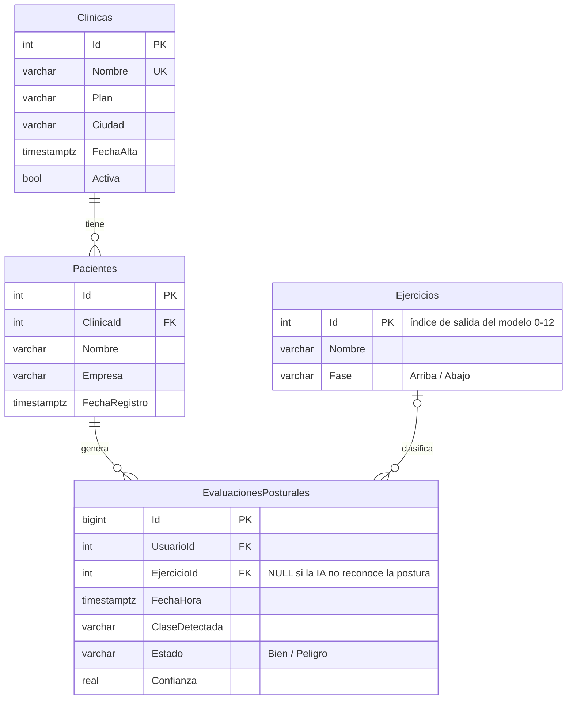

# Base de datos: Posture AI

Capa de persistencia del modelo SaaS B2B de Posture AI. Guarda el historial de evaluaciones posturales que genera la IA para que cada clínica o empresa cliente pueda consultar el seguimiento de sus pacientes.

| | |
|---|---|
| **Motor** | PostgreSQL (alojado en la nube: Neon) |
| **ORM** | Entity Framework Core 10 + Npgsql |
| **Creación del esquema** | Migración `InicialPostureAI`, que se aplica sola al iniciar la app |
| **Conexión** | `ConnectionStrings:DefaultConnection`, solo por variable de entorno o *user-secrets* |

## Diagrama entidad-relación



## Tablas

| Tabla | Propósito | Notas |
|---|---|---|
| `Clinicas` | Clientes B2B que contratan la suscripción | Nombre único; `Plan` = Basico / Profesional / Empresarial |
| `Pacientes` | Personas evaluadas por la cámara (equivale a *Usuarios* de la guía) | FK a `Clinicas` con `RESTRICT`: no se borra una clínica con pacientes |
| `Ejercicios` | Catálogo de las 13 clases del modelo MLP | El `Id` es el índice de salida del modelo ONNX, no autoincremental |
| `EvaluacionesPosturales` | Historial de ejercicios y alertas de riesgo | Índices en `(UsuarioId, FechaHora)` y `Estado` para las consultas de historial |

**Datos semilla:** la migración inserta la *Clínica Demo Posture AI*, el *Paciente Demo* (Id 1) y los 13 ejercicios. Si el frontend no envía `pacienteId`, las evaluaciones se guardan a nombre del paciente demo.

## Qué se guarda y cuándo

El frontend envía unos 3 fotogramas por segundo. Para no llenar la base, `Data/ControlRegistros.cs` filtra los registros:

- **Postura de riesgo** (`Estado = "Peligro"`, confianza de la IA < 90 %): como máximo un registro cada 5 segundos por paciente.
- **Ejercicio reconocido** (`Estado = "Bien"`): un registro cada vez que cambia la clase (por ejemplo, de *Press de hombro (Abajo)* a *(Arriba)*). Así el historial cuenta repeticiones.

Si la base de datos falla o no está configurada, la IA sigue respondiendo normalmente; solo se deja de guardar el historial.

## Endpoints de consulta

| Método | Ruta | Descripción |
|---|---|---|
| GET | `/health/db` | Estado de la conexión y conteo de registros por tabla |
| GET | `/api/Historial/clinicas` | Clínicas registradas y número de pacientes |
| GET | `/api/Historial/clinica/{id}/pacientes` | Pacientes de una clínica con sus evaluaciones y alertas |
| GET | `/api/Historial/clinica/{id}/metricas` | Métricas B2B: total, alertas, % de riesgo, ejercicios más realizados |
| GET | `/api/Historial/paciente/{id}?limite=50&soloRiesgo=true` | Historial de un paciente |
| POST | `/api/Historial/pacientes` | Registrar paciente: `{ "clinicaId": 1, "nombre": "...", "empresa": "..." }` |
| POST | `/api/EvaluacionFisica/Clasificar` | (ya existía) Ahora acepta un `pacienteId` opcional y guarda el resultado |

## Configuración

### En la nube (Cloud Run)

En el servicio de Cloud Run, agregar la variable de entorno:

```
ConnectionStrings__DefaultConnection = Host=<host>;Database=<db>;Username=<usuario>;Password=<contraseña>;SSL Mode=Require
```

(Doble guion bajo `__`: así ASP.NET Core lee `ConnectionStrings:DefaultConnection` desde una variable de entorno.)

### En local

```bash
cd "Frontend_VisionComputadoraWeb/Frontend_Posture AI"
dotnet user-secrets init
dotnet user-secrets set "ConnectionStrings:DefaultConnection" "Host=...;Database=...;Username=...;Password=...;SSL Mode=Require"
dotnet run
```

**Nunca** escribir la cadena de conexión en `appsettings.json` ni subirla al repositorio.

## Archivos

| Archivo | Contenido |
|---|---|
| `Models/Entidades/*.cs` | Entidades `Clinica`, `Paciente`, `Ejercicio`, `EvaluacionPostural` |
| `Data/AppDbContext.cs` | Contexto de EF Core: relaciones, índices y datos semilla |
| `Data/ControlRegistros.cs` | Filtro de qué evaluaciones se guardan |
| `Data/EstadoBaseDatos.cs` | Indica si hay base configurada |
| `Migrations/` | Migración inicial generada por EF Core |
| `Controllers/HistorialController.cs` | API de historial y métricas |
| `database/schema.sql` | Script SQL del esquema (idempotente) |
| `database/consultas_demo.sql` | Consultas SQL para mostrar en el pitch |
